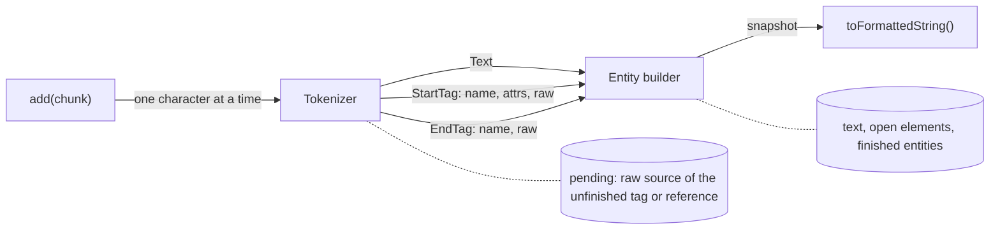
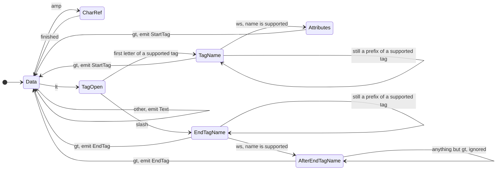
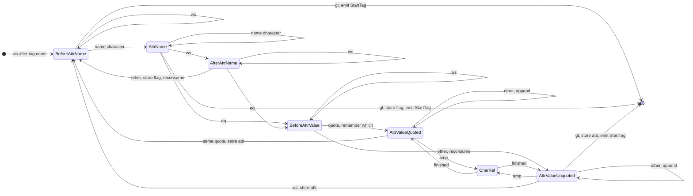
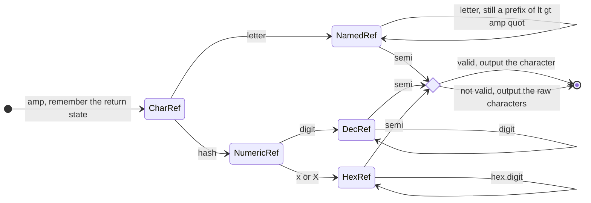
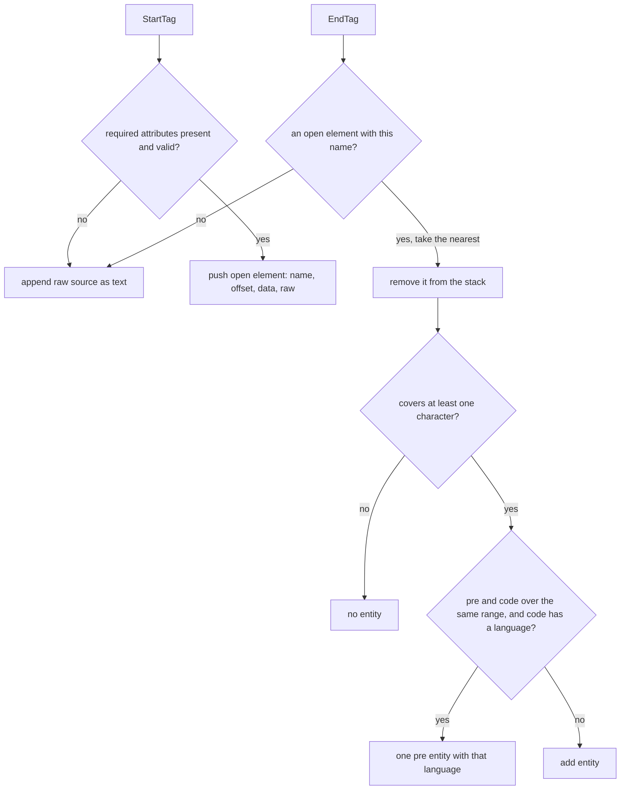

# HTML Formatting

This document describes the HTML formatting style supported by the Telegram Bot API and how each HTML element maps to `MessageEntity` types and `FormattedString` methods in this library.

## Overview

HTML is a flexible formatting mode that uses familiar HTML tags. It's often easier to work with than MarkdownV2 because it doesn't require escaping as many special characters.

### Special Characters

The following characters must be replaced with HTML entities:

| Character | HTML Entity |
| --------- | ----------- |
| `<`       | `&lt;`      |
| `>`       | `&gt;`      |
| `&`       | `&amp;`     |

Telegram also accepts the named entity `&quot;` and numeric entities such as `&#65;` or `&#x41;`. `HTMLStreamParser` decodes exactly these four named entities and numeric entities, and only with a terminating `;`; see [Parser behaviour](#parser-behaviour).

---

## Entity Reference

| HTML Tag                                    | MessageEntity Type      | FormattedString Method                      |
| ------------------------------------------- | ----------------------- | ------------------------------------------- |
| `<b>`, `<strong>`                           | `bold`                  | `FormattedString.bold()`                    |
| `<i>`, `<em>`                               | `italic`                | `FormattedString.italic()`                  |
| `<u>`, `<ins>`                              | `underline`             | `FormattedString.underline()`               |
| `<s>`, `<strike>`, `<del>`                  | `strikethrough`         | `FormattedString.strikethrough()`           |
| `<span class="tg-spoiler">`, `<tg-spoiler>` | `spoiler`               | `FormattedString.spoiler()`                 |
| `<code>`                                    | `code`                  | `FormattedString.code()`                    |
| `<pre>`                                     | `pre`                   | `FormattedString.pre()`                     |
| `<pre><code class="language-xxx">`          | `pre` (with `language`) | `FormattedString.pre(text, "xxx")`          |
| `<a href="url">`                            | `text_link`             | `FormattedString.link(text, url)`           |
| `<a href="tg://user?id=123">`               | `text_link`             | `FormattedString.mentionUser(text, userId)` |
| `<tg-emoji emoji-id="123">`                 | `custom_emoji`          | `FormattedString.emoji(text, emojiId)`      |
| `<blockquote>`                              | `blockquote`            | `FormattedString.blockquote()`              |
| `<blockquote expandable>`                   | `expandable_blockquote` | `FormattedString.expandableBlockquote()`    |
| `<tg-time unix="123" format="d">`           | `date_time`             | `FormattedString.time(text, unix, format)`  |

---

## Detailed Entity Descriptions

### Bold

**HTML Syntax:**

```html
<b>bold text</b>
<strong>bold text</strong>
```

**MessageEntity:**

```json
{ "type": "bold", "offset": 0, "length": 9 }
```

**FormattedString Usage:**

```typescript
import { bold, fmt, FormattedString } from "@grammyjs/parse-mode";

// Using entity tag
const fromFmt = fmt`${bold}bold text${bold}`;

// Using static method
const fromStatic = FormattedString.bold("bold text");

// Using static method (alias)
const fromAlias = FormattedString.b("bold text");
```

---

### Italic

**HTML Syntax:**

```html
<i>italic text</i>
<em>italic text</em>
```

**MessageEntity:**

```json
{ "type": "italic", "offset": 0, "length": 11 }
```

**FormattedString Usage:**

```typescript
import { fmt, FormattedString, italic } from "@grammyjs/parse-mode";

const fromFmt = fmt`${italic}italic text${italic}`;
const fromStatic = FormattedString.italic("italic text");
const fromAlias = FormattedString.i("italic text"); // alias
```

---

### Underline

**HTML Syntax:**

```html
<u>underline text</u>
<ins>underline text</ins>
```

**MessageEntity:**

```json
{ "type": "underline", "offset": 0, "length": 14 }
```

**FormattedString Usage:**

```typescript
import { fmt, FormattedString, underline } from "@grammyjs/parse-mode";

const fromFmt = fmt`${underline}underline text${underline}`;
const fromStatic = FormattedString.underline("underline text");
const fromAlias = FormattedString.u("underline text"); // alias
```

---

### Strikethrough

**HTML Syntax:**

```html
<s>strikethrough text</s>
<strike>strikethrough text</strike>
<del>strikethrough text</del>
```

**MessageEntity:**

```json
{ "type": "strikethrough", "offset": 0, "length": 18 }
```

**FormattedString Usage:**

```typescript
import { fmt, FormattedString, strikethrough } from "@grammyjs/parse-mode";

const fromFmt = fmt`${strikethrough}strikethrough text${strikethrough}`;
const fromStatic = FormattedString.strikethrough("strikethrough text");
const fromAlias = FormattedString.s("strikethrough text"); // alias
```

---

### Spoiler

**HTML Syntax:**

```html
<span class="tg-spoiler">spoiler text</span>
<tg-spoiler>spoiler text</tg-spoiler>
```

**MessageEntity:**

```json
{ "type": "spoiler", "offset": 0, "length": 12 }
```

**FormattedString Usage:**

```typescript
import { fmt, FormattedString, spoiler } from "@grammyjs/parse-mode";

const fromFmt = fmt`${spoiler}spoiler text${spoiler}`;
const fromStatic = FormattedString.spoiler("spoiler text");
```

---

### Inline Code

**HTML Syntax:**

```html
<code>inline code</code>
```

**MessageEntity:**

```json
{ "type": "code", "offset": 0, "length": 11 }
```

**FormattedString Usage:**

```typescript
import { code, fmt, FormattedString } from "@grammyjs/parse-mode";

const fromFmt = fmt`${code}inline code${code}`;
const fromStatic = FormattedString.code("inline code");
```

> **Note:** Code entities cannot be combined with other formatting (bold, italic, etc.).

---

### Pre-formatted Code Block

**HTML Syntax (without language):**

```html
<pre>pre-formatted code</pre>
```

**HTML Syntax (with language):**

```html
<pre><code class="language-python">print("Hello")</code></pre>
```

**MessageEntity:**

```json
{ "type": "pre", "offset": 0, "length": 18 }
{ "type": "pre", "offset": 0, "length": 14, "language": "python" }
```

**FormattedString Usage:**

```typescript
import { fmt, FormattedString, pre } from "@grammyjs/parse-mode";

// Without language
const fromFmt = fmt`${pre()}pre-formatted code${pre}`;

// With language
const fromFmtLang = fmt`${pre("python")}print("Hello")${pre}`;
const fromStatic = FormattedString.pre('print("Hello")', "python");
```

> **Note:** Pre entities cannot be combined with other formatting.

---

### Text Link

**HTML Syntax:**

```html
<a href="https://example.com">link text</a>
```

**MessageEntity:**

```json
{ "type": "text_link", "offset": 0, "length": 9, "url": "https://example.com" }
```

**FormattedString Usage:**

```typescript
import { fmt, FormattedString, link } from "@grammyjs/parse-mode";

const fromFmt = fmt`${link("https://example.com")}link text${link}`;
const fromStatic = FormattedString.link("link text", "https://example.com");
const fromAlias = FormattedString.a("link text", "https://example.com"); // alias
```

---

### User Mention (Text Mention)

**HTML Syntax:**

```html
<a href="tg://user?id=123456789">user name</a>
```

**MessageEntity:**

```json
{
  "type": "text_link",
  "offset": 0,
  "length": 9,
  "url": "tg://user?id=123456789"
}
```

**FormattedString Usage:**

```typescript
import { FormattedString, mentionUser } from "@grammyjs/parse-mode";

const fromFunc = mentionUser("user name", 123456789);
const fromStatic = FormattedString.mentionUser("user name", 123456789);
```

---

### Custom Emoji

**HTML Syntax:**

```html
<tg-emoji emoji-id="5368324170671202286">👍</tg-emoji>
```

**MessageEntity:**

```json
{
  "type": "custom_emoji",
  "offset": 0,
  "length": 2,
  "custom_emoji_id": "5368324170671202286"
}
```

**FormattedString Usage:**

```typescript
import { emoji, fmt, FormattedString } from "@grammyjs/parse-mode";

const fromFmt = fmt`${emoji("5368324170671202286")}👍${emoji}`;
const fromStatic = FormattedString.emoji("👍", "5368324170671202286");
```

---

### Blockquote

**HTML Syntax:**

```html
<blockquote>Block quotation text</blockquote>
```

**MessageEntity:**

```json
{ "type": "blockquote", "offset": 0, "length": 20 }
```

**FormattedString Usage:**

```typescript
import { blockquote, fmt, FormattedString } from "@grammyjs/parse-mode";

const fromFmt = fmt`${blockquote}Block quotation text${blockquote}`;
const fromStatic = FormattedString.blockquote("Block quotation text");
```

---

### Expandable Blockquote

**HTML Syntax:**

```html
<blockquote expandable>Expandable quotation text</blockquote>
```

**MessageEntity:**

```json
{ "type": "expandable_blockquote", "offset": 0, "length": 25 }
```

**FormattedString Usage:**

```typescript
import {
  expandableBlockquote,
  fmt,
  FormattedString,
} from "@grammyjs/parse-mode";

const fromFmt =
  fmt`${expandableBlockquote}Expandable quotation text${expandableBlockquote}`;
const fromStatic = FormattedString.expandableBlockquote(
  "Expandable quotation text",
);
```

---

### Date Time

**HTML Syntax:**

```html
<tg-time unix="1773412200">2026-05-21</tg-time>
<tg-time unix="1773412200" format="d">2026-05-21</tg-time>
```

**MessageEntity:**

```json
{
  "type": "date_time",
  "offset": 0,
  "length": 10,
  "unix_time": 1773412200,
  "date_time_format": "d"
}
```

**FormattedString Usage:**

```typescript
import { fmt, FormattedString, time } from "@grammyjs/parse-mode";

// Using entity tag
const fromFmt = fmt`${time(1773412200, "d")}2026-05-21${time}`;

// Using static method
const fromStatic = FormattedString.time("2026-05-21", 1773412200, "d");
```

---

## Nesting Rules

HTML supports rich nesting of formatting elements:

- **Allowed nesting:** `<b>`, `<i>`, `<u>`, `<s>`, `<span class="tg-spoiler">`, and `<a>` can be nested within each other
- **Cannot nest:** `<code>` and `<pre>` elements cannot contain or be contained by other formatting
- **Blockquotes:** Can contain other formatting but cannot be nested within other blockquotes

### Example: Nested Formatting

```html
<b><i>bold and italic</i></b>
<u><b>underlined bold</b></u>
```

```typescript
import { bold, fmt, italic, underline } from "@grammyjs/parse-mode";

// Bold italic text
const boldItalic = fmt`${bold}${italic}bold and italic${italic}${bold}`;

// Underlined bold text
const underlinedBold =
  fmt`${underline}${bold}underlined bold${bold}${underline}`;
```

---

## Unsupported HTML

Only the tags listed above are supported. Telegram rejects a message containing any other tag with an error; `HTMLStreamParser` keeps such tags as literal text instead (see [Parser behaviour](#parser-behaviour)):

- No support for `<br>`, `<p>`, `<div>`, `<span>` (except with a `tg-spoiler` class)
- No support for CSS styling via `style` attribute
- No support for ``, `<video>`, or other media tags
- No comments, doctype, or self-closing tags such as `<b />`
- Attributes other than those specified above are ignored

---

## Parser behaviour

`HTMLStreamParser` turns Telegram HTML into a `FormattedString` while the input is still arriving, for example from a streamed LLM response. Input can be added in chunks that split anywhere, including inside tags, attributes and entities, and every chunking gives the same result.

```typescript
import { HTMLStreamParser } from "@grammyjs/parse-mode";

const parser = new HTMLStreamParser();
parser.add("<b>Hello</b> <i>wor");
parser.toFormattedString(); // "Hello wor", bold "Hello"
parser.toFormattedString({ ended: true }); // "Hello <i>wor", bold "Hello"
parser.add("ld</i>");
parser.toFormattedString(); // "Hello world", bold "Hello", italic "world"
```

### The governing rule

**Syntax is read permissively, the way HTML5 reads it. Meaning follows Telegram. Anything that is not a well-formed supported tag or character reference stays in the output as literal text.**

Telegram answers malformed HTML with a 400 error. A streaming parser cannot do that, so the plaintext fallback takes the place of every error.

### Two stages

As in the HTML5 specification, a tokenizer that only recognizes syntax is separated from an entity builder that decides what the tokens mean.



The tokenizer owns the undecided input. The builder owns everything already decided. Every tag token carries its raw source so the builder can still turn a rejected tag into literal text.

Taken from HTML5: the state names; a character reference sub-machine with a return state, shared by text and both kinds of attribute value; reconsuming a character in another state; case-insensitive names; first duplicate attribute wins; class lists; ignoring attributes on end tags.

Different from HTML5: a fixed list of 17 tag names, checked as a prefix on every character so ordinary text such as `1 < 2` is released immediately; literal text where HTML5 would report a parse error and carry on; four named references only, always with a semicolon; no comments, doctype, self-closing tags or raw-text elements.

### The three moves

| Move        | Meaning                                                                                                                                                        |
| ----------- | -------------------------------------------------------------------------------------------------------------------------------------------------------------- |
| `emit`      | The construct is complete. Send a token to the builder, clear `pending`, return to Data.                                                                       |
| `bail`      | This was not a tag after all. Send `pending` to the builder as text, then reconsume the current character in Data. This single move is the plaintext fallback. |
| `reconsume` | Switch state and process the same character again there.                                                                                                       |

To keep the diagrams readable they show only the transitions that make progress. **In a tag state, any character with no arrow means `bail`.**

Character names used on the arrows:

| Name    | Character      |
| ------- | -------------- |
| `lt`    | `<`            |
| `gt`    | `>`            |
| `amp`   | `&`            |
| `slash` | `/`            |
| `eq`    | `=`            |
| `quote` | `"` or `'`     |
| `hash`  | `#`            |
| `semi`  | `;`            |
| `ws`    | any whitespace |

### Diagram 1: text and tag names



CharRef and Attributes are sub-machines drawn below. An end tag needs a complete supported name, so `</>` bails. A second `<` while a name is being read bails and starts a new tag.

### Diagram 2: attributes



- A name character is anything except whitespace, `=`, `>`, `/` and quotes. Names are lowercased. Meeting `/` or a quote where a name is expected bails, which is why `<b />` is literal text.
- "Store" keeps the first value seen for a name and ignores later ones.
- An attribute without a value (a flag) is stored when its name ends. `expandable` on `blockquote` is the only flag with a meaning.
- In AttrValueUnquoted a quote, `<`, `=` or backtick bails. In BeforeAttrValue a `>` bails, because the value is missing.

### Diagram 3: character references



One sub-machine serves three callers: Data, AttrValueQuoted and AttrValueUnquoted. "Output" appends to the text or to the attribute value, depending on the return state. Any character with no arrow ends the attempt: the raw characters are output as written and that character is reconsumed in the return state.

A reference is valid when the name is exactly `lt`, `gt`, `amp` or `quot`, or the number is above 0, below U+10FFFF and not a surrogate. A failed reference inside an attribute value does not bail the tag; its characters simply become part of the value.

### Diagram 4: the entity builder



All validation and all stack handling sit here, once. Elements opened after the one being closed stay open, which is what permits overlapping entities. Start tag validation: `a` needs `href`; `span` needs a `tg-spoiler` class token; `tg-emoji` needs a non-zero integer `emoji-id`; `tg-time` needs an integer `unix` and, if present, a valid `format`.

### Two snapshots

`toFormattedString()` can be called at any time. Both snapshots are non-mutating and idempotent, more input can still be added after either, and both return entities sorted.

- **Intermediate**, `toFormattedString()`: undecided input and the start tags of unclosed elements are left out, so nothing flashes on screen mid-stream. The content of unclosed elements is kept, without an entity.
- **As if ended**, `toFormattedString({ ended: true })`: the undecided input is appended as literal text and each unclosed start tag is put back where it stood, without an entity. Entities that begin after a restored tag move right by its length; entities that enclose it grow by its length. At the same text offset, source order decides: in `<b><i>x</i>` the restored `<b>` comes before the italic, which moves; in `<i><b>x</i>` it is inside the italic, which grows.

| Input so far   | Intermediate               | As if ended                   |
| -------------- | -------------------------- | ----------------------------- |
| `tail &amp`    | `tail`                     | `tail &amp`                   |
| `tail <b`      | `tail`                     | `tail <b`                     |
| `<a href="x`   | empty                      | `<a href="x`                  |
| `<b>unclosed`  | `unclosed`, no entity      | `<b>unclosed`, no entity      |
| `<i>a</i><b>b` | `ab`, italic at 0 length 1 | `a<b>b`, italic at 0 length 1 |

### Decisions and differences from Telegram

"Telegram today" is read from TDLib's `parse_html` source, the code Telegram runs for `parse_mode: "HTML"`, not tested against the live API. Where Telegram returns a 400 error this parser always produces literal text instead; that fallback applies to every row and is only spelled out where it is the whole difference.

| #  | Topic                                 | Telegram today                                                                                                                                                 | This parser                                                                                                                                                                              | Deviation from Telegram                                                                                                                                                     |
| -- | ------------------------------------- | -------------------------------------------------------------------------------------------------------------------------------------------------------------- | ---------------------------------------------------------------------------------------------------------------------------------------------------------------------------------------- | --------------------------------------------------------------------------------------------------------------------------------------------------------------------------- |
| 1  | References in quoted attribute values | Decoded. `href="?a=1&amp;b=2"` gives `?a=1&b=2`.                                                                                                               | Decoded, in quoted and unquoted values.                                                                                                                                                  | Identical                                                                                                                                                                   |
| 2  | Semicolon on references               | Optional. `AT&amp T` gives `AT& T`.                                                                                                                            | Required.                                                                                                                                                                                | A reference without `;` stays literal text here.                                                                                                                            |
| 3  | Input left undecided at end of stream | Sees the whole message at once. A trailing `&` is literal, a trailing `&amp` decodes, an unfinished tag is a 400 error.                                        | Two snapshots: intermediate, and as-if-ended.                                                                                                                                            | The ended snapshot shows an unfinished tag as literal text where Telegram returns an error. A trailing `&amp` stays literal because of decision 2.                          |
| 4  | Unclosed tags                         | 400 error: no end tag for the start tag.                                                                                                                       | Never an entity. Intermediate shows `unclosed`; ended shows literal `<b>unclosed`.                                                                                                       | Literal text where Telegram returns an error.                                                                                                                               |
| 5  | Empty tags `<b></b>`                  | No entity.                                                                                                                                                     | No entity.                                                                                                                                                                               | Identical                                                                                                                                                                   |
| 6  | Empty end tag `</>`                   | Closes the innermost open tag.                                                                                                                                 | Literal text.                                                                                                                                                                            | `<b>x</>` is bold in Telegram and not here.                                                                                                                                 |
| 7  | `pre` and `code` language             | One `pre` with language only when both cover the same range, in either nesting order. Otherwise separate entities, `code` without language.                    | Same rule, also decided against the most recently closed entity.                                                                                                                         | Identical                                                                                                                                                                   |
| 8  | Duplicate attributes                  | Last value wins.                                                                                                                                               | First value wins, as in HTML5.                                                                                                                                                           | `href="1" href="2"` gives 2 in Telegram and 1 here.                                                                                                                         |
| 9  | `&#0;`                                | Not decoded; stays literal text.                                                                                                                               | Literal text.                                                                                                                                                                            | Identical                                                                                                                                                                   |
| 10 | Length of numeric references          | Not decoded once `&#` plus digits reaches 10 characters. `&#000000065;` stays literal.                                                                         | No limit.                                                                                                                                                                                | `&#000000065;` decodes to "A" here.                                                                                                                                         |
| 11 | `&#x10FFFF;`                          | Not decoded; the accepted range ends at U+10FFFE.                                                                                                              | Literal text.                                                                                                                                                                            | Identical                                                                                                                                                                   |
| 12 | Junk inside tags                      | Only whitespace may follow an end tag name, otherwise a 400 error. `<b />` is a 400 error (empty attribute name).                                              | Anything after an end tag name is ignored up to `>`. `<b />` and `<b/>` are literal text.                                                                                                | `</b foo>` closes the tag here. `<b />` is rejected by both, as literal text here.                                                                                          |
| 13 | Entity order                          | Sorted by offset; on a tie the longer entity comes first.                                                                                                      | Sorted with the existing `sortEntities`: by offset, then shorter first, then type.                                                                                                       | Tie order is reversed: inner before outer here.                                                                                                                             |
| 14 | Unquoted attribute values             | Only letters, digits, `.` and `-`; lowercased; never decoded. Anything else is a 400 error.                                                                    | Any characters up to whitespace or `>`, case kept, references decoded. A quote, `<`, `=` or backtick inside one makes the tag literal text, so a URL with a query string must be quoted. | Accepts values Telegram rejects, such as `href=https://e.com`. Keeps case where Telegram lowercases. Decodes references where Telegram does not.                            |
| 15 | Attribute name case                   | Case-sensitive. `HREF` is ignored as an unknown attribute.                                                                                                     | Case-insensitive, as in HTML5.                                                                                                                                                           | `<a HREF="…">` is a link here.                                                                                                                                              |
| 16 | `class` matching                      | `span`: the class must be exactly `tg-spoiler`, otherwise a 400 error. `code`: the class must start with `language-`, and everything after it is the language. | A whitespace-separated class list. `span` needs a `tg-spoiler` token; `code` takes its language from the first `language-xxx` token.                                                     | `class="foo tg-spoiler"` is accepted here. `class="x language-py"` gives py here and no language in Telegram. `class="language-py x"` gives py here and "py x" in Telegram. |
| 17 | `emoji-id`                            | Must be a non-zero integer, otherwise a 400 error.                                                                                                             | Must be a non-zero decimal integer, otherwise the tag is literal text. Kept as written in `custom_emoji_id`.                                                                             | Same values accepted. Literal text where Telegram returns an error.                                                                                                         |
| 18 | Misnested end tags                    | An end tag must match the innermost open tag, otherwise a 400 error.                                                                                           | An end tag closes the nearest open tag with the same name. An end tag with no open tag of that name is literal text.                                                                     | `<b><i>x</b>y</i>` gives overlapping bold and italic here.                                                                                                                  |
| 19 | `<a>` without `href`                  | The link text is used as the URL. The link is dropped silently if that is not a valid URL.                                                                     | Literal text, tags included. A bare or empty `href` counts as missing.                                                                                                                   | `<a>https://e.com</a>` is a link in Telegram and literal text here.                                                                                                         |
